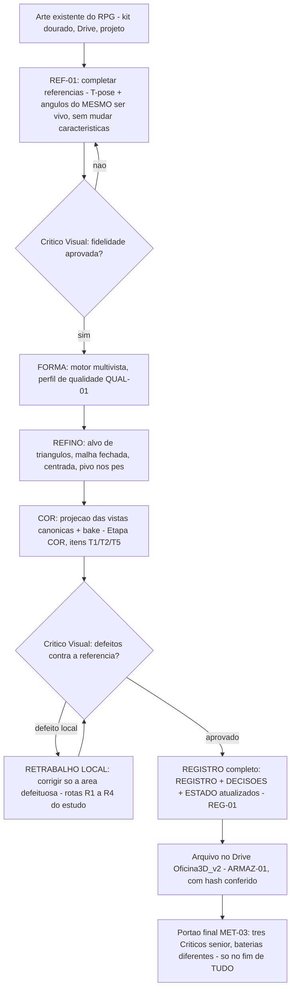

# APRENDIZADO E FLUXO - Oficina 3D

Documento vivo criado por **APR-01** (ordem do Mestre, 01/11/2026, 01:54) e regido por **REG-01** (01/11/2026, 01:57).
Serve a tres coisas: (1) ensinar o executor atual e os proximos agentes/comestres a fazer o trabalho da Oficina; (2) transformar cada erro e cada negada do Critico numa licao permanente, para o erro nao se repetir; (3) obrigar o executor a ANTECIPAR o que o Critico negaria - e o Critico, em resposta, a ficar mais rigoroso a cada rodada.
Atualizar a CADA tranche de trabalho (ver protocolo REG-01 abaixo). Documento sem atualizacao = documento morto: quem perceber, cobra.

---

## 1. Fluxograma geral do trabalho

O mesmo fluxo em texto, para quem nao renderiza mermaid:

1. **Referencia** - parte-se SEMPRE da arte existente do RPG (nunca inventar ser vivo novo). Se faltam angulos ou pose util, a frente REF-01 os completa a partir da arte que existe.
2. **Critico Visual de fidelidade** - a referencia nova so entra no arsenal se o Critico confirmar: mesmo personagem, caracteristicas intactas.
3. **Forma** - motor multivista com o perfil de qualidade (QUAL-01) adequado ao teste.
4. **Refino** - malha no alvo de triangulos do perfil, fechada, centrada, pivo nos pes.
5. **Cor** - Etapa COR: projecao das vistas canonicas com bake (padrao), cor de vertice como rede de seguranca.
6. **Critico Visual de defeitos** - cacada de defeitos contra a referencia (taxonomia da secao 7 do ESTUDO_MELHORIAS). Defeito local vai para o **retrabalho local**, nunca para o refazer-tudo.
7. **Registro** - nada esta pronto sem REGISTRO/DECISOES/ESTADO escritos e commitados (REG-01).
8. **Arquivo** - o que sai de uso vai para o Drive com hash conferido (ARMAZ-01). PC do cunhado sempre enxuto.
9. **Portao final** - MET-03 so quando TODAS as frentes terminarem.

---

## 2. Protocolo REG-01 (permanente) - nunca confiar na memoria

1. O plano valido e o que esta ESCRITO nos documentos do projeto (ESTADO_ATUAL + backlog do ESTUDO_MELHORIAS + REVISAO_E_ROTEIRO). Nunca o que esta na cabeca de um agente.
2. Toda tranche de trabalho COMECA relendo o plano dos arquivos e TERMINA atualizando o plano por escrito (o que mudou, o que foi concluido, qual e o proximo passo) ANTES do commit final.
3. Memoria de conversa e so ponteiro: divergiu do arquivo, vale o arquivo - e a divergencia e corrigida no ato, nos dois sentidos (se o arquivo estava errado, corrige-se o arquivo com o registro do motivo).

---

## 3. Protocolo de antecipacao - checklist pre-Critico

Antes de convocar o Critico, o executor confere e resolve CADA item. A ideia (APR-01): dificultar o trabalho do Critico resolvendo antes o que ele negaria - e force-lo a procurar mais fundo.

- [ ] `git status` limpo; TUDO o que sera anunciado ja esta commitado e pushado (local == remoto conferido). [licao C3-1]
- [ ] Toda decisao citada existe como linha em DECISOES.md; o ESTADO nao afirma nada sem lastro (commit, linha, arquivo de resultado). [licoes C3-2/C3-3]
- [ ] Nenhum arquivo existente foi sobrescrito sem diff conferido antes (testes, docs, configuracao). [licao N1]
- [ ] Suite de testes rodada no interpretador de producao (`.venv_app`), com a contagem real conferida arquivo a arquivo - nunca numero de memoria. [licao N1]
- [ ] Arte do RPG fora do git: `git check-ignore` confirmado para cada PNG/GLB novo (regra GIT-04; pastas `testes/dourado/imagens/` e `testes/referencias/`).
- [ ] Comparacao visual contra a referencia feita PELO EXECUTOR antes: olho, zoom nas areas de risco (maos, armas, rosto, juncoes) e wireframe quando houver malha. Metrica (IoU de silhueta) NAO substitui olho. [licao do machado]
- [ ] Todos os numeros citados (tempos, VRAM, triangulos, hashes, tamanhos) vieram de arquivo de resultado lido nesta tranche - nao de memoria. [REG-01]
- [ ] Espelho/arquivo no Drive conferido por hash (MD5/SHA-256) na ida e na volta - nunca por nome de arquivo. [licao do espelho G:]
- [ ] Scripts e estado de trabalho vivos em pasta persistente (`~/workspace` ou no PC) - nunca so em `/tmp`. [licao /tmp]
- [ ] Acesso ao PC: scripts dos helpers SEMPRE pelo STDIN; chamadas curtas; trabalho longo so via tarefa agendada com arquivo de status. [licao helpers-SSH]
- [ ] Novidade da rodada registrada: qual verificacao NOVA esta bateria pede ao Critico (regra de escalada, secao 5).

---

## 4. Diario de licoes

Cada licao nasce de um caso real. Formato: caso -> o que aconteceu -> custo -> regra que nasceu (e onde ela mora).

### L-01 - N1: sobrescrever arquivo apaga trabalho alheio (31/10/2026)
- **Caso:** o commit 8030d4b sobrescreveu `testes/test_motores.py` e apagou 19 dos 24 testes; a suite real era 180 testes, nao os 199 anunciados.
- **Custo:** auditoria no 2 do Critico = NAO PRONTA; retrabalho na mesma noite para fundir as versoes (24 antigos + 5 novos = 29 no arquivo; suite real 204).
- **Regra:** nunca sobrescrever arquivo existente sem diff conferido; a contagem da suite se prova rodando, arquivo a arquivo. (Checklist pre-Critico, itens 3-4.)

### L-02 - C3-1: anunciar antes de commitar (01/11/2026)
- **Caso:** o QUAL-01 (perfis de qualidade) funcionava e foi anunciado ao Mestre, mas o codigo ficou horas FORA do git - um clone do GitHub nao teria a funcionalidade anunciada.
- **Custo:** auditoria no 3 = NAO PRONTA por itens documentais; correcao imediata (commit 3dfda89) e adendo do Critico.
- **Regra:** commitar o codigo ANTES de anunciar a funcionalidade. Sem commit + push + arvore limpa, nao existe "pronto". (Checklist, item 1.)

### L-03 - C3-2/C3-3: documento sem lastro (01/11/2026)
- **Caso:** o ESTADO citava o QUAL-01 como "registrado em DECISOES" sem a linha existir, e afirmava o item 6 da definicao de pronta sem evidencia apontavel.
- **Custo:** parte do NAO PRONTA da auditoria no 3.
- **Regra:** afirmacao em documento so com lastro apontavel (hash de commit, linha de DECISOES, arquivo de resultado). (Checklist, item 2.)

### L-04 - O machado do Orc Lenario: metrica nao substitui olho (01/11/2026)
- **Caso:** defeito EXT+FUS, severidade S2, achado pelo MESTRE (nao pela bateria): o machado do Orc em qualidade Lendario saiu com laminas multiplas/fundidas; a referencia tem lamina unica e larga. A nota de silhueta (IoU) tinha passado com o defeito presente.
- **Custo:** caso inaugural da frente de retrabalho local; nenhum nivel de qualidade pode ser aprovado sem Critico Visual desde entao.
- **Regra:** toda aprovacao visual exige olho treinado com zoom e taxonomia de defeitos (ESTUDO_MELHORIAS, secao 7); metrica objetiva e complemento, nunca substituto. (Checklist, item 6.)

### L-05 - Helpers SSH leem do STDIN (31/10-01/11/2026)
- **Caso:** `run-pc-ps.py`/`run-notebook-ps.py` leem o script PowerShell do STDIN e IGNORAM o argumento em argv. Chamadas por argv geraram timeouts e a conclusao errada de que as maquinas estavam inalcancaveis.
- **Custo:** horas de diagnostico errado na madrugada de 01/11.
- **Regra:** script sempre pelo STDIN; antes de declarar uma maquina inalcancavel, sondar outra porta pelo proxy (ex.: 445) para separar "rede caiu" de "servico caiu". (Checklist, item 10.)

### L-06 - O /tmp da VM e apagado em restart (31/10-01/11/2026)
- **Caso:** restarts do servico apagaram o /tmp da VM duas vezes (31/10 ~20:34 e 01/11 ~00:29), quebrando em silencio o lancamento de uma bateria.
- **Custo:** bateria perdida sem erro visivel; diagnostico confundido com travamento no PC.
- **Regra:** scripts vivos, estado e copias de trabalho moram em `~/workspace` (ou no PC) - /tmp e so rascunho descartavel. (Checklist, item 9.)

### L-07 - Espelho do Drive exige hash (31/10-01/11/2026)
- **Caso:** o espelho do REGISTRO via G: falhou em silencio (pasta com "a" com til nao casou; noutra noite a leitura voltou 0 bytes com o DriveFS rodando).
- **Custo:** espelho pendente sem alarme; o lastro real ficou sendo PC + GitHub.
- **Regra:** espelho so vale com hash conferido na volta (MD5/SHA-256) e caminho resolvido por curinga, nunca por nome acentuado digitado. (Checklist, item 8.)

### L-08 - Decimacao x motor: isolar a variavel antes de culpar (01/11/2026)
- **Caso:** o Orc "turbo" de baixa qualidade visual nao era culpa do motor turbo: rodando o MESMO turbo sem o aperto do refino (alvo de 500 mil triangulos), a forma saiu com 760.690 triangulos em 38,7 s. O dano era da decimacao para 49.750, nao do motor.
- **Custo:** quase virou decisao errada de troca de motor.
- **Regra:** antes de culpar um componente, rodar o mesmo pipeline variando UM parametro por vez. (Metodo geral; vale para motores, perfis e parametros.)

### L-09 - Convencao de pose tem de ser explicita no pedido (01/11/2026)
- **Caso:** a bateria da T-pose pedia "palmas para baixo", mas a T-pose v2 (aprovada) saiu com as palmas voltadas para a frente - defeito D15 (DEF S4), achado pelo Critico da rodada 2. A geometria das maos estava toda legivel e os dedos contaveis, por isso nao bloqueou a aprovacao.
- **Custo:** ressalva permanente no arsenal do Orc; um detalhe de convencao que o gerador nao adivinha.
- **Regra:** todo pedido de geracao de referencia lista as convencoes de pose por extenso (palmas para baixo, pes para a frente, pernas afastadas, lado de cada acessorio) - nada de convencao implicita. (Checklist pre-Critico, item 6: conferir as convencoes antes de convocar o Critico.)

---

## 5. Regra de escalada do Critico (APR-01)

O executor melhora antecipando; o Critico responde subindo a regua. E assim para sempre:

1. Cada bateria nova do Critico adiciona **pelo menos 1 verificacao que a bateria anterior nao tinha**.
2. A verificacao adicionada e **registrada na propria bateria** (e na tabela abaixo), para a escalada ser auditavel.
3. Uma negada do Critico vira licao no Diario (secao 4) e item do checklist de antecipacao (secao 3) - o mesmo erro nao pode ser cobrado duas vezes; na segunda, e falha do executor, nao do Critico.

| Data | Bateria | Verificacao ADICIONADA (a anterior nao tinha) | O que pegou |
|---|---|---|---|
| 31/10/2026 | Auditoria no 2 (Fase 1) | Contagem real da suite arquivo por arquivo, no interpretador de producao | N1 (19 testes apagados; suite 180, nao 199) |
| 01/11/2026 | Auditoria no 3 (Fase 1) | Conferencia de lastro documental: afirmacao x commit x linha em DECISOES | C3-1, C3-2, C3-3 (QUAL-01 sem commit e sem linha) |
| 01/11/2026 | Bateria REF-01 lote 1 (abaixo) | Consistencia cruzada ENTRE as vistas geradas (vista x vista, nao so vista x fonte) + checagem geometrica da T-pose (simetria medida na imagem) | Verificado na rodada 2: consistencia cruzada PASSA nas 3 vistas v2; simetria medida (IoU 0,809, extensoes 653 px/lado) |
| 01/11/2026 | Rodada 2 REF-01 lote 1 v2 | Contagem de dedos por mao com zoom (numero contado, nao estimado) + simetria espelhada MEDIDA da silhueta (IoU mascara x espelho) + auditoria de ancoras de LADO, ancora por ancora, nas costas v2 E no 3/4 v2 (16/16) | D1/D2/D3/D10 fechados; D15 (palmas para a frente, S4) achado |

---

## 6. Bateria do Critico Visual - REF-01, lote 1 (Orc)

**Alvos:** `testes/referencias/orc_tpose.png` e `testes/referencias/orc_angulos.png` (no PC; copias locais com o executor).
**Fontes de verdade:** `testes/dourado/imagens/orc_frente.png` (fonte primaria) e os demais cardeais dourados do Orc.
**Divergencia consciente registrada:** o BRIEF de 27/10 pedia corpo-base SEM armadura; a ordem REF-01 do Mestre (01/11, 01:54) manda NAO mudar as caracteristicas - vale a ordem nova: o Orc aparece COMO ELE E (armadura, capa de pele, peca de lobo), so muda a pose. O machado nao precisa estar na pose.

Verificacoes (responder item a item, com evidencia visual):

1. **Mesmo personagem?** Cara: testa pesada, orelhas pontudas, presas inferiores, cavanhaque preto, cicatrizes vermelhas no rosto; pele verde-oliva; proporcoes (ombros muito largos, maos grandes, corpo largo) identicas as da fonte.
2. **Caracteristicas preservadas?** Peca de lobo sobre o ombro, capa de pele, ombreira de espinhos, braceletes e caneleiras de metal com espinhos, colar de presas com caveira, faixa/cinto com tecido vermelho, cabelo em dreads presos. Nada removido, nada inventado (sem arma nova, sem acessorio novo, sem mudanca de cores).
3. **T-pose correta (imagem 1)?** Bracos retos na horizontal, palmas para baixo, dedos separados e contaveis; simetria esquerda x direita conferida.
4. **Pernas como pedido?** Um pouco afastadas, retas, pes para a frente - sem grudarem uma na outra nem se fundirem ao saiote/tecidos.
5. **Enquadramento e fundo:** corpo inteiro sem cortes (cabeca, maos e pes dentro do quadro, com margem); fundo limpo e uniforme, sem cenario, sem texto, sem sombra projetada forte.
6. **Folha de angulos (imagem 2):** frente, costas, esquerda, direita e 3/4 sao o MESMO personagem - consistencia cruzada de equipamento, cores e proporcoes entre as 5 vistas; costas coerente (capa de pele e cabelo por tras); laterais coerentes com a frente.
7. **Integridade tecnica:** PNG valido; dimensoes, tamanho e SHA-256 registrados; arquivo FORA do git (`git check-ignore` confirma) e copia local de seguranca existente.
8. **Classificacao de defeitos:** cada defeito achado classificado na taxonomia do estudo (EXT/MIS/FUS/DEF/SIL/SYM/FACE/PRP/TXT) com severidade S1-S4.

**Criterio de aceite:** nenhum defeito S1/S2 de fidelidade; defeitos S3/S4 registrados viram pendencia nomeada do proximo lote. Quem aprova em ultima instancia e o Mestre (a palavra do Critico e tecnica; a da fidelidade artistica e dele).

### Leitura do executor (antecipacao) - lote 1, 01/11/2026

O executor conferiu as imagens ANTES do Critico (protocolo de antecipacao) e ja entrega os desvios achados - o Critico parte deles e tem de ir alem:

1. **Folha de angulos sem a vista de costas (MIS):** a folha trouxe frente, 3/4 e perfis - um perfil quase duplicado - e NENHUMA vista de costas, justamente a que "completa o que nao aparece". Remedio na mesma tranche: `orc_costas_ref.png` avulsa. Licao candidata para o Diario: folha multi-vista e fragil para vistas criticas; vista critica se pede AVULSA (o BRIEF de 27/10 ja dizia: uma vista por geracao).
2. **T-pose relaxada (SYM/DEF):** bracos ~20-25 graus abaixo da horizontal; dedos macios, parcialmente fundidos (FUS leve); tecido da cintura tocando as coxas por dentro.
3. **Costas com o lobo espelhado (SYM):** na fonte, a peca de lobo fica no ombro esquerdo do personagem - vista por tras, deveria aparecer a esquerda de quem olha; saiu a direita. A ombreira de espinhos, em compensacao, ficou no lado certo.
4. **Completacao nao pedida (EXT leve):** bolsinhas de couro no cinto da vista de costas - plausiveis, mas nao constam da arte de frente.
5. **Estilo mais liso (TXT leve):** a pintura gerada e mais lisa que a textura da arte-fonte; cores e desenho se mantiveram.

### Fila dos proximos sujeitos do arsenal (somente candidatos REAIS, localizados)

1. **Besta Cristalina (monstro)** - arte dourada instalada no PC: `testes/dourado/imagens/besta_{frente,costas,esquerda,direita}.png` (768x512); kit completo de 8 vistas recuperavel do Drive pelo indice da auditoria do Codex (relatorio de continuidade v002). Pose: a mais adequada a modelagem de uma criatura serpentina de cristal - sem T-pose.
2. **Caprileo (monstro)** - arte dourada instalada: `testes/dourado/imagens/caprileo_{frente,costas,esquerda,direita}.png`; 8 vistas no mesmo indice do Drive. Pose adequada de quadrupede.
3. **Orc - vistas diagonais** - o kit original tem 8 angulos; alem dos 4 cardeais instalados, as diagonais sao recuperaveis do Drive pelo mesmo indice (completar o conjunto de entrada multivista).
4. **Bestas novas de 31/10 (Drive)** - 5 referencias em `05 - Imagens e referencias/Referencias visuais/2026-10-31_RPG_besta-*.jpg` ("besta lendaria" / "besta do vazio"), localizadas pela sessao do Claude no PC e registradas no REGISTRO; nao foram usadas na Prova C (nao sao o kit nomeado). Classificar: se forem seres vivos com arte aproveitavel, entram na fila REF-01.
