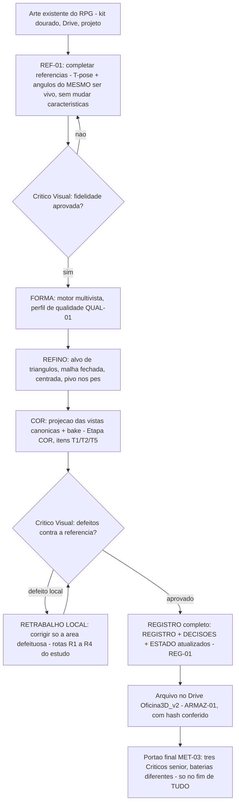

# APRENDIZADO E FLUXO - Oficina 3D

Documento vivo criado por **APR-01** (ordem do Mestre, 01/11/2026, 01:54) e regido por **REG-01** (01/11/2026, 01:57).
Serve a tres coisas: (1) ensinar o executor atual e os proximos agentes/comestres a fazer o trabalho da Oficina; (2) transformar cada erro e cada negada do Critico numa licao permanente, para o erro nao se repetir; (3) obrigar o executor a ANTECIPAR o que o Critico negaria - e o Critico, em resposta, a ficar mais rigoroso a cada rodada.
Atualizar a CADA tranche de trabalho (ver protocolo REG-01 abaixo). Documento sem atualizacao = documento morto: quem perceber, cobra.

---

## 1. Fluxograma geral do trabalho

O mesmo fluxo em texto, para quem nao renderiza mermaid:

1. **Referencia** - parte-se SEMPRE da arte existente do RPG (nunca inventar ser vivo novo). Se faltam angulos ou pose util, a frente REF-01 os completa a partir da arte que existe.
2. **Critico Visual de fidelidade** - a referencia nova so entra no arsenal se o Critico confirmar: mesmo personagem, caracteristicas intactas.
3. **Forma** - motor multivista com o perfil de qualidade (QUAL-01) adequado ao teste.
4. **Refino** - malha no alvo de triangulos do perfil, fechada, centrada, pivo nos pes.
5. **Cor** - Etapa COR: projecao das vistas canonicas com bake (padrao), cor de vertice como rede de seguranca.
6. **Critico Visual de defeitos** - cacada de defeitos contra a referencia (taxonomia da secao 7 do ESTUDO_MELHORIAS). Defeito local vai para o **retrabalho local**, nunca para o refazer-tudo.
7. **Registro** - nada esta pronto sem REGISTRO/DECISOES/ESTADO escritos e commitados (REG-01).
8. **Arquivo** - o que sai de uso vai para o Drive com hash conferido (ARMAZ-01). PC do cunhado sempre enxuto.
9. **Portao final** - MET-03 so quando TODAS as frentes terminarem.

---

## 2. Protocolo REG-01 (permanente) - nunca confiar na memoria

1. O plano valido e o que esta ESCRITO nos documentos do projeto (ESTADO_ATUAL + backlog do ESTUDO_MELHORIAS + REVISAO_E_ROTEIRO). Nunca o que esta na cabeca de um agente.
2. Toda tranche de trabalho COMECA relendo o plano dos arquivos e TERMINA atualizando o plano por escrito (o que mudou, o que foi concluido, qual e o proximo passo) ANTES do commit final.
3. Memoria de conversa e so ponteiro: divergiu do arquivo, vale o arquivo - e a divergencia e corrigida no ato, nos dois sentidos (se o arquivo estava errado, corrige-se o arquivo com o registro do motivo).

---

## 3. Protocolo de antecipacao - checklist pre-Critico

Antes de convocar o Critico, o executor confere e resolve CADA item. A ideia (APR-01): dificultar o trabalho do Critico resolvendo antes o que ele negaria - e force-lo a procurar mais fundo.

- [ ] `git status` limpo; TUDO o que sera anunciado ja esta commitado e pushado (local == remoto conferido). [licao C3-1]
- [ ] Toda decisao citada existe como linha em DECISOES.md; o ESTADO nao afirma nada sem lastro (commit, linha, arquivo de resultado). [licoes C3-2/C3-3]
- [ ] Nenhum arquivo existente foi sobrescrito sem diff conferido antes (testes, docs, configuracao). [licao N1]
- [ ] Suite de testes rodada no interpretador de producao (`.venv_app`), com a contagem real conferida arquivo a arquivo - nunca numero de memoria. [licao N1]
- [ ] Arte do RPG fora do git: `git check-ignore` confirmado para cada PNG/GLB novo (regra GIT-04; pastas `testes/dourado/imagens/` e `testes/referencias/`).
- [ ] Comparacao visual contra a referencia feita PELO EXECUTOR antes: olho, zoom nas areas de risco (maos, armas, rosto, juncoes) e wireframe quando houver malha. Metrica (IoU de silhueta) NAO substitui olho. [licao do machado]
- [ ] Todos os numeros citados (tempos, VRAM, triangulos, hashes, tamanhos) vieram de arquivo de resultado lido nesta tranche - nao de memoria. [REG-01]
- [ ] Espelho/arquivo no Drive conferido por hash (MD5/SHA-256) na ida e na volta - nunca por nome de arquivo. [licao do espelho G:]
- [ ] Scripts e estado de trabalho vivos em pasta persistente (`~/workspace` ou no PC) - nunca so em `/tmp`. [licao /tmp]
- [ ] Acesso ao PC: scripts dos helpers SEMPRE pelo STDIN; chamadas curtas; trabalho longo so via tarefa agendada com arquivo de status. [licao helpers-SSH]
- [ ] Novidade da rodada registrada: qual verificacao NOVA esta bateria pede ao Critico (regra de escalada, secao 5).
- [ ] Medicao de arestas em malha vinda de GLB solda vertices por posicao (tolerancia 1e-6) - sem solda, costura subcontada e bordas falsas. [licao L-24]
- [ ] Direcao de vista em medicao fora do Blender esta no frame das normais (GLB: costas = -Z; converter Blender->glTF (x,y,z)->(x,z,-y)) - vetor Blender cru mede o eixo errado. [licao L-25]
- [ ] Vistas geradas entregues com autotestes geometricos MEDIDOS pelo executor: lateralizacao das diagonais contra a familia canonica (ancora lateralizada nao cruza a linha media) e pureza da planta (elemento frontal nao le de frente; se le inteiro, NAO e topo e nao se entrega com esse rotulo). Desvio estrutural nunca descrito com diminutivo ("levemente", "quase") sem medida que o sustente. [licao L-26]
- [ ] Deploy de worker em loop: matar o processo com a fila vazia e deixar o supervisor relancar (o processo vivo NAO herda codigo novo sozinho); confirmar o PID novo + o lock antes de criar o job de prova. [licao L-28]
- [ ] Numero da suite nunca carregado entre tranches: re-medir por discovery e reconciliar commit a commit (o log antigo pode ser de arvore anterior ao ultimo commit de testes). [licao L-29]
- [ ] Checagem de lado ANTES de instalar qualquer vista gerada: cabeca, cauda, flanco, motivo do chifre/ancora lateralizada e correlacao com o perfil correspondente; rotulo e parte da fidelidade, nao metadado cosmetico; conferir tambem rotulos textuais existentes que citem o arquivo pelo nome antigo. [licao L-34]
- [ ] Comparacao de previas do Blender por IDAT/pixels, nunca por bytes brutos: o Blender grava metadado tEXt (Date, RenderTime) que muda a cada render sem mudar um pixel. [licao L-32]
- [ ] Docstring de tempo distingue chamada nativa de total: "nativa (~97 s)" quando a nativa e 84 s e o total 97 s vira divergencia documental na proxima auditoria. [licao S4-1 da D-COR05]
- [ ] Probe grava o resultado de cada caso ao terminar (ou tolera o erro esperado): resumo so no fim se perde no primeiro caso que falha por desenho. [licao L-35]
- [ ] Verificador reprova entrada malformada em vez de excecao, e guarda valida a completude da entrada antes de julgar (chaves obrigatorias; entrada incompleta = recusa). [licoes L-36/L-37]
- [ ] Lateralizacao do PAR medida, nao so de cada imagem isolada: um par dir/esq so e aceito se cumprir OS TRES criterios de N2 (IoU entre as silhuetas < 0,85; assimetria da faixa inferior INVERTIDA entre elas, > 1,4 de um lado e < 0,7 do outro; pe em perfil em lados opostos). Cada traseira isolada passava nas ancoras de costas; o defeito era do par. [licao L-38]
- [ ] Pureza do 3/4 traseiro (N1) conferida antes de submeter: rosto SO em perfil parcial, capa dominando o dorso abaixo da cintura, pes apontando para longe do observador. [licao L-38]
- [ ] Tom medido por amostragem anatomica (N3), nao a olho: mesma caixa anatomica na fonte e no lote, filtro oliva, mediana RGB + saturacao, com o saiote vermelho como controle interno (delta <= 3). [licao L-38]
- [ ] Caminho de salvamento de textura no Blender: `view_transform` fixo em `Standard` antes de `save_render`; nunca julgar cor pelo `textura.png` salvo sob o default AgX (branco 255 vira 197) — amostrar o GLB ate o fix. [licao L-39]
- [ ] IoU medido a 256 px e invariante ao tamanho da textura: nunca usa-lo para provar efeito de resolucao; e campo de metrica com nome que nao corresponde ao conteudo (dilatacao total sob o nome 'restrita') e defeito, nao detalhe. [licao L-40]
- [ ] Status de prova regenerado apos qualquer correcao: artefato que guarda corrida velha (suite FAILED pre-correcao) contradiz o log final e mente no registro — reescrever/anotar antes do commit, com o original preservado. [licao L-41]
- [ ] Ancora conferida por SHA/tamanho antes de comparar: diretorio de job pode guardar bake antigo (1024) e nao a reproducao COR-08 (2048, cor08rep) — comparar contra a ancora errada diverge sem ser defeito. [licao L-42]

- [ ] Lateralizacao por vista cruzada (N4) antes de escrever qualquer item de especificacao de lado: para cada item fixo ao corpo, registrar o lado em imagem em TODAS as vistas aprovadas/canonicas; exigir da vista nova a coerencia com a sua familia (traseiras com traseiras, frontais com frontais), nunca um espelho postulado. [licao L-43]
- [ ] Novidade angular medida (N5) antes de instalar qualquer vista nova: IoU bbox-alinhado contra TODAS as vistas ja aprovadas do mesmo personagem; IoU > 0,90 contra vista aprovada do mesmo lado = angulo duplicado, reprova como adicao, qualquer que seja a qualidade do render. [licao L-43]
- [ ] Leitura obrigatoria dos vereditos anteriores (N6): antes de julgar um retrabalho, o Critico le TODOS os relatorios anteriores sobre as mesmas imagens/personagem e, para cada afirmacao decisiva anterior, ou a reproduz com medicao propria ou a refuta explicitamente com medicao propria. Julgar sem ler invalida o veredito, mesmo quando o checklist local passa. [licao L-43]
- [ ] Regra nova nao retroage seletivamente (N7): toda regra nova e executada contra TODAS as vistas ja aprovadas da familia ANTES de ser aplicada a candidata; se a regra reprova uma autoridade aprovada, quem volta para revisao e a regra, nao a autoridade; um mesmo traco jamais recebe severidades diferentes em imagens diferentes sem diferenca medida entre elas. [licao L-43]
- [ ] Coordenada decisiva exige grade e referencial (N8): toda coordenada x/y usada como evidencia decisiva e lida em recorte com grade impressa (ou computada por script) e declara o referencial (imagem x bbox) e a convencao de qualquer razao (dir/esq x esq/dir). Coordenada "a olho" sem grade nao e medicao. [licao L-43]
- [ ] REGRA FINAL do Orc (familia das vistas): kit fixo ao corpo exatamente como nas vistas aprovadas da mesma familia — caveira grande sempre a DIREITA do losango e alca sempre na diagonal superior-esquerda → inferior-direita em coordenadas de imagem; mudam de lado apenas os sinais da camera (lobo, ombreira, perfil do rosto, pe em perfil). Fisica de corpo rigido NAO governa este arsenal (o canone viola a faixa continua e o anel rigido) — quem governa e o canone. [licao L-43]

---

## 4. Diario de licoes

Cada licao nasce de um caso real. Formato: caso -> o que aconteceu -> custo -> regra que nasceu (e onde ela mora).

### L-01 - N1: sobrescrever arquivo apaga trabalho alheio (31/10/2026)
- **Caso:** o commit 8030d4b sobrescreveu `testes/test_motores.py` e apagou 19 dos 24 testes; a suite real era 180 testes, nao os 199 anunciados.
- **Custo:** auditoria no 2 do Critico = NAO PRONTA; retrabalho na mesma noite para fundir as versoes (24 antigos + 5 novos = 29 no arquivo; suite real 204).
- **Regra:** nunca sobrescrever arquivo existente sem diff conferido; a contagem da suite se prova rodando, arquivo a arquivo. (Checklist pre-Critico, itens 3-4.)

### L-02 - C3-1: anunciar antes de commitar (01/11/2026)
- **Caso:** o QUAL-01 (perfis de qualidade) funcionava e foi anunciado ao Mestre, mas o codigo ficou horas FORA do git - um clone do GitHub nao teria a funcionalidade anunciada.
- **Custo:** auditoria no 3 = NAO PRONTA por itens documentais; correcao imediata (commit 3dfda89) e adendo do Critico.
- **Regra:** commitar o codigo ANTES de anunciar a funcionalidade. Sem commit + push + arvore limpa, nao existe "pronto". (Checklist, item 1.)

### L-03 - C3-2/C3-3: documento sem lastro (01/11/2026)
- **Caso:** o ESTADO citava o QUAL-01 como "registrado em DECISOES" sem a linha existir, e afirmava o item 6 da definicao de pronta sem evidencia apontavel.
- **Custo:** parte do NAO PRONTA da auditoria no 3.
- **Regra:** afirmacao em documento so com lastro apontavel (hash de commit, linha de DECISOES, arquivo de resultado). (Checklist, item 2.)

### L-04 - O machado do Orc Lenario: metrica nao substitui olho (01/11/2026)
- **Caso:** defeito EXT+FUS, severidade S2, achado pelo MESTRE (nao pela bateria): o machado do Orc em qualidade Lendario saiu com laminas multiplas/fundidas; a referencia tem lamina unica e larga. A nota de silhueta (IoU) tinha passado com o defeito presente.
- **Custo:** caso inaugural da frente de retrabalho local; nenhum nivel de qualidade pode ser aprovado sem Critico Visual desde entao.
- **Regra:** toda aprovacao visual exige olho treinado com zoom e taxonomia de defeitos (ESTUDO_MELHORIAS, secao 7); metrica objetiva e complemento, nunca substituto. (Checklist, item 6.)

### L-05 - Helpers SSH leem do STDIN (31/10-01/11/2026)
- **Caso:** `run-pc-ps.py`/`run-notebook-ps.py` leem o script PowerShell do STDIN e IGNORAM o argumento em argv. Chamadas por argv geraram timeouts e a conclusao errada de que as maquinas estavam inalcancaveis.
- **Custo:** horas de diagnostico errado na madrugada de 01/11.
- **Regra:** script sempre pelo STDIN; antes de declarar uma maquina inalcancavel, sondar outra porta pelo proxy (ex.: 445) para separar "rede caiu" de "servico caiu". (Checklist, item 10.)

### L-06 - O /tmp da VM e apagado em restart (31/10-01/11/2026)
- **Caso:** restarts do servico apagaram o /tmp da VM duas vezes (31/10 ~20:34 e 01/11 ~00:29), quebrando em silencio o lancamento de uma bateria.
- **Custo:** bateria perdida sem erro visivel; diagnostico confundido com travamento no PC.
- **Regra:** scripts vivos, estado e copias de trabalho moram em `~/workspace` (ou no PC) - /tmp e so rascunho descartavel. (Checklist, item 9.)

### L-07 - Espelho do Drive exige hash (31/10-01/11/2026)
- **Caso:** o espelho do REGISTRO via G: falhou em silencio (pasta com "a" com til nao casou; noutra noite a leitura voltou 0 bytes com o DriveFS rodando).
- **Custo:** espelho pendente sem alarme; o lastro real ficou sendo PC + GitHub.
- **Regra:** espelho so vale com hash conferido na volta (MD5/SHA-256) e caminho resolvido por curinga, nunca por nome acentuado digitado. (Checklist, item 8.)

### L-08 - Decimacao x motor: isolar a variavel antes de culpar (01/11/2026)
- **Caso:** o Orc "turbo" de baixa qualidade visual nao era culpa do motor turbo: rodando o MESMO turbo sem o aperto do refino (alvo de 500 mil triangulos), a forma saiu com 760.690 triangulos em 38,7 s. O dano era da decimacao para 49.750, nao do motor.
- **Custo:** quase virou decisao errada de troca de motor.
- **Regra:** antes de culpar um componente, rodar o mesmo pipeline variando UM parametro por vez. (Metodo geral; vale para motores, perfis e parametros.)

### L-09 - Convencao de pose tem de ser explicita no pedido (01/11/2026)
- **Caso:** a bateria da T-pose pedia "palmas para baixo", mas a T-pose v2 (aprovada) saiu com as palmas voltadas para a frente - defeito D15 (DEF S4), achado pelo Critico da rodada 2. A geometria das maos estava toda legivel e os dedos contaveis, por isso nao bloqueou a aprovacao.
- **Custo:** ressalva permanente no arsenal do Orc; um detalhe de convencao que o gerador nao adivinha.
- **Regra:** todo pedido de geracao de referencia lista as convencoes de pose por extenso (palmas para baixo, pes para a frente, pernas afastadas, lado de cada acessorio) - nada de convencao implicita. (Checklist pre-Critico, item 6: conferir as convencoes antes de convocar o Critico.)

### L-10 - Blender 5.2: ray_cast sem acerto nao devolve None; BVH exige transform aplicado (01/11/2026)
- **Caso:** o teste de oclusao do bake (T1) quebrou com `TypeError` na primeira face: `BVHTree.ray_cast` sem acerto devolve `(None, None, None, None)`, nao `None`. Em paralelo, o cubo sintetico estava sem `transform_apply`: os vertices lidos de `me.vertices` estavam em coords locais (z=0) enquanto o BVH trabalhava em coords de mundo (z=1) - o enquadramento e a oclusao sairiam deslocados sem erro visivel.
- **Custo:** um run sintetico perdido; o erro so apareceu porque o script checa o retorno do raio em vez de confiar no `None`.
- **Regra:** em codigo Blender, tratar "sem acerto" como `hit is None or hit[0] is None`; e, antes de qualquer BVH ou leitura de vertices para calculo, aplicar location/rotation/scale do objeto (o `importar_glb` ja fazia; o `criar_cubo` nao fazia). Teste minimo de raio (cubo, 6 faces) antes de depurar o bake inteiro.

### L-11 - Medir a UV antes de culpar a projecao; entrada errada nao e defeito do mecanismo (01/11/2026)
- **Caso:** o primeiro run do Orc falhou ("malha sem UV") porque a entrada era `refino/limpa.glb` - que e a ENTRADA do refino (via pymeshlab, sem UV), nao a saida refinada (`saida/modelo.glb`, com UV). Depois, com a entrada certa, a cobertura direta de so 20% parecia defeito da projecao - mas a medida independente (decode do GLB) mostrou a causa real: o Smart UV do refino cobre 4,32% do quadrado UV (8.098 ilhas), ou seja, ~1 texel por face em 1024 px. A projecao nao tinha resolucao para pintar detalhe.
- **Custo:** um run perdido + uma conclusao quase errada ("a projecao nao presta") que teria condenado o mecanismo certo pelo gargalo errado.
- **Regra:** (1) conferir o que cada arquivo de job realmente e (entrada vs saida da etapa) antes de usa-lo como insumo; (2) antes de julgar um bake, medir a UV (area total, ilhas, ocupacao) por via independente do codigo sob teste - e o T5 que protege o T1, nao o contrario. (Eco da L-08: isolar a variavel antes de culpar.)

### L-13 - Prova sem artefato nao e prova; nome de teste tem de dizer o que ele testa (01/11/2026)
- **Caso:** o Critico do T1-mecanismo nao reprovou o mecanismo, mas negou o determinismo "como provado": o REGISTRO trazia so a frase "2 runs deram SHA identicos", sem nenhum artefato do 1o run para um auditor conferir. No mesmo relatorio: o teste `test_maior_facing_vence` usava duas vezes a mesma vista (testava o empate) e o IoU sintetico 1,0 era vacuo (mascara solida estica qualquer geometria para 1,0).
- **Custo:** re-prova do determinismo com 2 runs novos guardados (detA/detB) + renomeacao do teste + teste verdadeiro de maior-facing; leitura do IoU corrigida no REGISTRO.
- **Regra:** (1) toda alegacao de determinismo/repeticao guarda os artefatos comparados (os dois resultado.json, nao so a frase com os hashes); (2) o nome do teste descreve o caso que ele realmente exercita - nome que promete mais do que o teste faz e defeito de teste, nao detalhe; (3) numero "perfeito" (IoU 1,0, 100%) exige perguntar "o que faria este numero NAO ser perfeito?" - se nada faria, ele nao prova nada. (Checklist pre-Critico, itens 2 e 7: lastro apontavel + numeros de arquivo lido.)

### L-12 - Tarefa agendada com cmd.exe: citacao e cwd quebram em silencio (01/11/2026)
- **Caso:** a suite completa via tarefa agendada falhou 2x: na primeira, o `cmd /c` rodou fora de `app` (ImportError "Start directory is not importable"); na segunda, o redirecionamento com citacao aninhada nao truncou o log e o erro antigo permaneceu no arquivo, parecendo "a mesma falha".
- **Custo:** duas rodadas de diagnostico confundido por log velho.
- **Regra:** trabalho agendado no PC usa um script `.py` proprio que fixa o cwd, escreve o proprio log e devolve o resumo (`SUITE_RESULT ...`) - nunca `cmd /c` com citacao aninhada; e log velho se apaga antes do run, nao depois.

---

### L-14 - Pack do Blender nao reescala ilhas; medir ocupacao antes de apostar numa estrategia de UV (01/11/2026)
- **Caso:** no experimento T5, `pack_islands` sobre o Smart UV so dobrou a ocupacao (0,040 -> 0,078) e `average_islands_scale` + pack chegou a 0,074: o pack rearranja as ilhas preservando a escala delas, nao as estica para encher o quadrado. O unwrap (0,175) ocupou 4x mais ao custo de distorcao 0,48-0,58. So o xatlas resolveu (0,614 com distorcao 0,088).
- **Custo:** uma rodada de experimento para descobrir o que o nome do operador nao deixa obvio.
- **Regra:** estrategia de UV se escolhe por medicao (ocupacao + distorcao + texels/face) na mesma malha, nunca pelo nome do operador ("pack" nao significa "encher").

### L-15 - Tarefa agendada: trigger Once + Start = duas execucoes (01/11/2026)
- **Caso:** a tarefa do experimento T5 foi registrada com trigger Once e disparada tambem com Start-ScheduledTask: duas execucoes concorrentes sobrescreveram o mesmo resultado.json (o arquivo lido no meio era parcial de uma delas, com `ok: false`).
- **Custo:** uma leitura de resultado confundida e um re-download para confirmar o arquivo final.
- **Regra:** run unico agendado usa Start-ScheduledTask SEM trigger, ou trigger sem Start - nunca os dois. (Complementa a L-12.)

### L-16 - np.load mantem o arquivo aberto; no Windows isso trava limpeza de diretorio temporario (01/11/2026)
- **Caso:** o teste de `gerar_uv` falhava so na limpeza do TemporaryDirectory (PermissionError WinError 32 no .npz), nao na assercao: o NpzFile do `np.load` nao tinha sido fechado.
- **Custo:** um falso-negativo de teste e uma rodada de diagnostico.
- **Regra:** `np.load` sempre em `with` (ou `.close()` explicito) quando o arquivo vive num diretorio temporario - e, em geral, no Windows, arquivo aberto e arquivo travado.

### L-17 - Controle que devolve o numero identico nao prova o mecanismo - e nao deve ser vendido como prova (01/11/2026)
- **Caso:** o controle "unwrap sem costuras" devolveu metricas identicas ate a 5a casa ao unwrap com costuras, o que REFUTA a hipotese "o importador glTF marca as costuras" - mas nao explica por que as ilhas travam em 8.098 em todas as estrategias Blender. A hipotese foi abandonada, a anomalia ficou aberta e foi entregue ao Critico como tal; o Critico depois explicou o controle (importador cria 0 costuras; limpar 0->0 e vacuo) e manteve a coincidencia das 8.098 ilhas como nao-explicada.
- **Custo:** nenhum, porque a anomalia nao foi maquiada de explicacao.
- **Regra:** resultado de controle identico ao original e informacao (a variavel testada nao move o resultado), nao confirmacao da teoria favorita; anomalia sem explicacao se registra como anomalia, nao como "comportamento do Blender".

### L-18 - Guarda prometida na docstring tem de existir no codigo que promete (01/11/2026)
- **Caso:** o Critico T5 achou S2: a docstring do `_blender_uv_xatlas.py` prometia `ok=False` se a ocupacao divergisse >0,02, mas o script nao comparava nada - a guarda vivia so no runner. A prova do Orc passou corretamente sem disparar, mas a promessa era falsa.
- **Custo:** correcao pos-veredito (guarda implementada no script + prova nos dois sentidos) em vez de um paragrafo de pendencia.
- **Regra:** docstring que promete comportamento de falha e especificacao testavel: ou o codigo cumpre, ou a docstring nao promete. (Checklist pre-Critico, item 2: lastro apontavel - vale tambem para o proprio codigo.)

### L-19 - Primeira linha do stdout some com o progresso CLIXML (01/11/2026)
Caso: ao ler a saida do helper SSH, a primeira linha real sumia (ex.: defaults
do PackOptions, lista de ChartOptions). Causa: o PowerShell emite o registro de
progresso em CLIXML no stdout sem quebra de linha no fim, e a primeira linha
real cola nele; o filtro `grep -v CLIXML` do Muse descartava o conjunto.
Custo: duas sondas repetidas e uma leitura errada (defaults "ausentes").
Regra: scripts de prova imprimem uma linha em branco sacrificada antes de
qualquer saida; leitura critica confere o ARQUIVO de log, nao so a tela.

### L-20 - Determinismo nao compara relogio (01/11/2026)
Caso: a prova da D-T5-1 reprovou o passo novo por `metricas_iguais=False`
quando os 3 arrays do .npz eram bit a bit identicos. Causa: a comparacao
incluia `tempo_s`, que varia entre runs e nao e dado do passo. Custo: uma
prova abortada no passo 0 e um re-run (suite + 2x gerar_uv + Blender + bake).
Regra: comparacao de determinismo exclui tempo de execucao (e qualquer outro
campo de medicao, nao de resultado); o que prova determinismo sao os
artefatos bit a bit + as metricas de resultado.

### L-21 - Nome do arquivo de saida entra no GLB (01/11/2026)
Caso: o det ponta a ponta "falhou" com modelo_cor.glb diferente embora a
textura, a geometria e as UVs fossem identicas. Causa: o bake nomeia a imagem
embutida pelo nome do arquivo de saida ("textura" vs "textura_det" = +4
bytes no GLB). Custo: um diagnostico completo (decode dos dois GLBs) ate
isolar a causa. Regra: prova de determinismo usa os MESMOS nomes de arquivo
de saida (pasta diferente, nomes iguais); se os nomes diferirem, compara-se
o conteudo (JSON do GLB + geometria + textura), nao o SHA do arquivo.

### L-22 - Previa PNG: comparar pixels, nao SHA (01/11/2026)
Caso: previas das rodadas 2 e 3 do bake tinham SHA diferente com 0 px
diferentes na frente. Causa: o PNG do Blender carrega metadado que varia
entre runs; o raster e identico. Regra: regressao visual de previas se mede
por diferenca de pixels (0 px = identica), nunca por SHA do arquivo.

### L-23 - Flip V duplo se cancela no modelo_cor.glb (01/11/2026)
Caso: o Critico D-T5-1 comparou as UVs do modelo_cor.glb com o .npz
aplicando o flip e achou maxdiff 1,0 (falso alarme). Causa: o
modelo_cor.glb passa por DOIS round-trips glTF (npz -> modelo_uv.glb ->
modelo_cor.glb) e o flip se cancela; sem flip, casa com maxdiff 2,98e-08.
O modelo_uv.glb (UM round-trip) precisa do flip; o modelo_cor.glb (DOIS)
nao. Custo: um falso alarme e uma re-medicao. Regra: antes de comparar
UVs de um GLB com o .npz, contar os round-trips do arquivo - 1 aplica o
flip, 2 nao aplica; o docstring de uv_xatlas.py documenta os dois casos.

### L-24 - GLB duplica vertices: classificar aresta por ID sem soldar inventa bordas (01/11/2026)
- **Caso:** a medicao D7 da Besta achou 37.456 "bordas" e costura 4.017.
  Causa: o GLB exportado duplica vertices (split por normal/UV) - a
  mesma posicao 3D com IDs diferentes. A classificacao por ID nao via
  a aresta compartilhada. O Critico soldou por posicao (1e-6) e achou
  a malha fechada: costura 13.758, borda 0, 74.625 classificadas.
- **Custo:** veredito D7 REPROVADO nesta tranche; republicacao sem
  novo bake com os numeros corrigidos (iguais, a casa decimal, aos
  do Critico).
- **Regra:** toda classificacao de aresta em malha vinda de GLB solda
  vertices por posicao antes de classificar (`costura.py`, parametro
  `verts`); teste de vertice duplicado na suite - o caso que deixou
  o bug passar. (Checklist pre-Critico, item novo.)

### L-25 - Vetor Blender aplicado a normal glTF mede o eixo errado (01/11/2026)
- **Caso:** o D2 sem-costas usou `direcao_camera("costas")` = (0,1,0)
  (frame Blender, Z-up) crua sobre normais do GLB (frame glTF, Y-up)
  e mediu topo/base - "separacao fraca" falsa. No frame certo (glTF,
  costas = (0,0,-1) pela conversao (x,y,z)->(x,z,-y)), a separacao e
  forte (alvo 28,23 vs controle 7,05).
- **Custo:** veredito D2 REPROVADO nesta tranche; republicacao sem
  novo bake. O bake nao foi afetado: dentro do Blender, vetor e
  normais vivem no mesmo frame.
- **Regra:** medicao fora do Blender converte a direcao para o frame
  das normais antes de usar (docstring de `costura.py` documenta a
  conversao); documentar o frame de toda tabela de direcoes usada
  fora do seu contexto de origem. (Checklist pre-Critico, item novo.)

### L-26 - Antecipacao ve o cosmetico e subestima o estrutural: geometria de camera se entrega MEDIDA, nao estimada (01/11/2026)
- **Caso:** no lote 2 da REF-01 (Besta Cristalina), a antecipacao do
  executor acertou os defeitos cosmeticos (bracos segmentados, franja
  da boca virando presas, cristal menor) mas chamou de "cabeca
  levemente elevada" uma boca 100% frontal (obliqua alta de ~40-55
  graus vendida como vista de topo) e defendeu como "ambiguidade de
  rotulo" um espelhamento de fato da diag_esq (a cauda cruzou a linha
  media: ponta em x=885/1000, centroide de cristais 0,557 contra
  0,481 canonico). Os dois defeitos estruturais (B1 SYM S2 e B2
  DEF/MIS S2) so apareceram com os testes geometricos NOVOS da
  bateria (atribuicao das diagonais e pureza da planta).
- **Custo:** lote 2 REPROVADO no criterio de aceite; diag_esq e topo
  voltam para retrabalho (a diag_dir foi aprovada e e utilizavel).
  Sem os testes novos, o conjunto multivista aprenderia a cauda nos
  dois lados e carregaria um rotulo "topo" falso - o mesmo dano do
  D10 (costas espelhadas) do lote 1.
- **Regra:** vista gerada se entrega com AUTOTESTE geometrico do
  executor, nunca com estimativa a olho: (a) em diagonal frontal,
  medir a lateralizacao (ancora + distribuicao dos pixels da classe
  assinatura) contra a familia canonica - cruzou a linha media, nao
  se entrega; (b) em vista de topo, o criterio e binario - se o
  elemento frontal (boca/rosto) le inteiro de frente, NAO e planta e
  nao se entrega com esse rotulo; (c) desvio estrutural nunca se
  descreve com diminutivo ("levemente", "quase") sem a medida que o
  sustente. (Checklist pre-Critico, item novo.)

### L-27 - Autoteste geometrico virou piso: o desvio migra para a forma fina e o tom (01/11/2026)
- **Caso:** no retrabalho do lote 2 da REF-01 (Besta Cristalina v2), TODOS os autotestes geometricos do executor se confirmaram por medicao independente (cauda x~24-27, centroide 0,483 contra 0,475 declarado, cobertura no piso canonico nas 3 escalas do Critico, planta com a boca reduzida a fenda) e os defeitos estruturais B1/B2 fecharam. O que escapou da antecipacao nao foi geometria: foi a FORMA de um elemento-assinatura (as maos da vista de topo sairam em roseta radial, contradizendo o feixe irregular das fontes e das diagonais - achado da verificacao nova de coerencia interna do conjunto, B10) e o TOM (cristal delta 32 mais saturado e pele delta 28 mais clara no topo, contra a frente canonica, B11). Ambos S3: sem bloqueio, mas o conjunto fecharia com uma contradicao interna silenciosa entre vistas sem a verificacao nova.
- **Regra:** junto do autoteste geometrico (L-26), a entrega de vista passa a incluir (a) autoteste de FORMA dos elementos-assinatura (maos, placa, roseta, franja) em zoom lado a lado contra a fonte E contra as vistas irmas do conjunto, e (b) autoteste de TOM (mediana por classe de cor contra a vista canonica de autoridade). Geometria medida e o piso; forma e tom medidos sao o novo teto da antecipacao. (Checklist pre-Critico, item novo.)

### L-28 - Worker em loop nao herda codigo novo: deploy exige reinicio com fila vazia (01/11/2026)
- **Caso:** na COR-05, o worker em loop desde 31/10 21:05 (PID 25544) tinha o codigo antigo carregado; criar o job de prova antes de reinicia-lo teria rodado SEM a etapa `cor` (a opcao nova seria ignorada em silencio pelo worker velho). Procedimento executado: fila vazia conferida (pendentes = []), kill do PID 25544, supervisor (`iniciar_worker.py`) relancou o worker (PID 31976, 01/11 10:14:18) com o codigo novo - confirmado por `worker_ativo()` + FAIXAS com `cor` e pelo `job.json` do job de prova (worker PID 31976).
- **Custo:** sem o reinicio, a prova teria "passado" sem testar nada do novo codigo.
- **Regra:** todo deploy que toca o worker termina com: (1) fila vazia conferida, (2) kill do processo em loop, (3) supervisor relanca, (4) PID novo + lock conferidos, (5) so entao criar o job de prova. (Checklist pre-Critico, item novo.)

### L-29 - Numero da suite nao se carrega: baseline se re-mede commit a commit (01/11/2026)
- **Caso:** a COR-05 anunciou "252 -> 263, +2 nao atribuidos". O Critico explicou: o `suite.log` da D2/D7 (252) era da arvore 17462aa (08:31:30), onde `test_cor_costura` tinha 5 testes; o commit aa2758c (08:45:57, posterior ao log) acrescentou 2 testes (5 -> 7); baseline correto pre-tranche = 254; 254 + 9 = 263. A ressalva do executor inverteu a direcao (os +2 vieram DO aa2758c, nao depois dele).
- **Custo:** uma pendencia fantasma registrada no REGISTRO e uma linha de ESTADO defasada (247) que sobreviveu a duas tranches.
- **Regra:** o numero da suite de uma tranche so vale com o log da PROPRIA tranche; comparar com o log anterior exige conferir o commit da arvore do log, nao o HEAD da epoca. (Checklist pre-Critico, item novo.)

### L-30 - Cancelamento em chamada nativa bloqueante: a garantia e abortar logo apos o retorno, antes de qualquer escrita (01/11/2026)
- **Caso:** na D-COR05, a `gerar_uv` (~97 s totais) contem uma chamada nativa de ~84 s que nao se interrompe no meio: o flag de cancelamento so surte efeito quando a chamada retorna. O desenho fechado pelo Critico: progresso emitido dentro da `gerar_uv` (0/20/30/80/90/100), re-cheque do cancelamento apos o retorno do passo e ANTES das copias finais para `saida/`, e o teste "progresso que levanta em >=80 nao grava .npz".
- **Custo:** sem o re-cheque, um cancelamento pedido durante a UV publicaria o artefato mesmo assim; sem o progresso, o usuario veria a etapa parada em 5% por ~100 s sem saber se travou.
- **Regra:** chamada nativa bloqueante nao se interrompe no meio — a garantia e (1) emitir progresso antes/durante ela quando possivel, (2) verificar o flag imediatamente apos o retorno, (3) abortar antes de qualquer escrita ou copia. (Checklist pre-Critico, item novo: deploy de worker ja cobre o reinicio; este cobre o cancelamento.)

### L-31 - Determinismo vs plumbing: progresso e campo novo no relatorio nao mudam nenhum byte de saida (01/11/2026)
- **Caso:** na D-COR05, a tranche so tocou plumbing (callbacks de progresso na UV, campo `glb_refinado_preservado` no relatorio) — e a reexecucao deterministica reproduziu byte a byte TODOS os artefatos da prova COR-05 (textura, modelo colorido, refinado, uv.npz, modelo_uv). O Critico confirmou que so mudaram caminhos e `tempo_s` nos JSONs de resultado.
- **Custo evitado:** confundir "mudou o codigo" com "mudou a saida" teria invalidado a prova COR-05 sem motivo — ou, pior, aceitar uma mudanca de saida como "so plumbing" sem reexecutar.
- **Regra:** tranche de plumbing se prova com reexecucao deterministica contra a prova anterior (SHAs devem reproduzir); divergencia de byte em artefato de conteudo = S2, nao "detalhe". (Checklist pre-Critico: numeros citados so de arquivo de resultado lido nesta tranche.)

### L-32 - Previa do Blender nao se compara por bytes brutos: compara-se IDAT/pixels (01/11/2026)
- **Caso:** na D-COR05, as 9 previas do job de determinismo tinham o mesmo tamanho em bytes que as da prova mas SHA diferente. Decomposicao dos chunks PNG pelo Critico: `IDAT` identico em todos os casos; a unica diferenca estava nos chunks `tEXt` do Blender (`Date` e `RenderTime`). Decodificacao pixel a pixel: 0 pixels diferentes em 512.000 por previa.
- **Custo:** comparar por bytes brutos teria declarado o determinismo quebrado por metadado — um falso S2.
- **Regra:** comparacao de previas do Blender = `IDAT` ou pixels; bytes brutos so valem para artefatos sem metadado de render (textura, GLB, .npz). (Checklist pre-Critico, item novo.)

### L-34 - Rotulo trocado e defeito de fidelidade: checagem de lado ANTES da instalacao (01/11/2026)
- **Caso:** o lote 3 do Caprileo chegou a instalacao com os rotulos das diagonais traseiras trocados; o defeito era de rotulo, nao de pixels, e nenhuma medicao de cor ou margem o pegaria - so a atribuicao de lado (5 ancoras) o pegou, ja com os arquivos instalados e com o relatorio da rodada 1 ainda fora dos docs do projeto.
- **Custo:** uma rodada inteira de retrabalho (renomeacao + re-verificacao + registro) para desfazer um erro que uma checagem de lado pre-instalacao teria pego; e um risco real de modelo espelhado se o rotulo errado tivesse sido usado.
- **Regra:** nenhuma vista entra no arsenal sem a checagem de lado feita ANTES da instalacao (cabeca, cauda, flanco, motivo do chifre/ancora lateralizada, correlacao com o perfil correspondente); ao renomear, renomear tambem as evidencias derivadas (zooms) e registrar o mapeamento novo por escrito (hashes por nome + convencao) junto do relatorio historico, para o mapeamento antigo nao sobreviver como unica referencia escrita. (Checklist pre-Critico, item novo.)

### L-35 - Probe que quebra no caso esperado perde o resumo: resultado por caso, nao so no fim (01/11/2026)
- **Caso:** o probe da D-T2 quebrou no caso X2 (o erro do passo era o comportamento ESPERADO da recusa) antes de gravar o resumo final - o `resumo_passo.json` alegado nunca existiu e os numeros ficaram espalhados em log + JSONs por job; o Critico teve de registrar a lacuna e reler os artefatos.
- **Custo:** uma ressalva documental no veredito e trabalho de re-leitura na auditoria seguinte.
- **Regra:** probe grava o resultado de CADA caso assim que ele termina (ou tolera o erro esperado e le o resultado parcial) - resumo final so no fim e resumo perdido no primeiro erro esperado. (Checklist pre-Critico, item novo.)

### L-36 - Verificador que quebra diante de entrada quebrada nao verifica: falhar fechado (01/11/2026)
- **Caso:** o `verificar_glb_vertice` (defesa em profundidade da D-T2-4) dava `IndexError` com acessor COLOR_0 invalido, em vez de `ok=False` - a defesa furava exatamente no caso quebrado.
- **Custo:** ressalva S4-1 do Critico e uma rodada de correcao + prova S41 no fechamento.
- **Regra:** funcao de verificacao trata entrada malformada como REPROVACAO, nunca como excecao: cada acesso a indice/contagem vai em guarda que conta o item como falho. (Checklist pre-Critico, item novo.)

### L-37 - Guarda que aceita entrada incompleta nao guarda: validar a completude do que ela checa (01/11/2026)
- **Caso:** `avaliar_alinhamento_forma` aceitava um dict de razoes com so o eixo X - os eixos ausentes simplesmente nao eram checados. O unico chamador real passa os tres eixos, mas a guarda, como funcao, aceitava ser contornada por omissao.
- **Custo:** ressalva S4-2 do Critico; o mesmo padrao de "guarda que nao guarda" que a D-T2-1 acabara de corrigir, em versao menor.
- **Regra:** toda guarda valida a COMPLETUDE da entrada antes de julgar (chaves obrigatorias presentes, tipos esperados) - entrada incompleta e recusa com motivo proprio, nunca aceite silencioso. (Checklist pre-Critico, item novo.)

### L-38 - Gerador repete o mesmo lado quando se pedem duas diagonais opostas: lateralizacao do PAR, nao da imagem (01/11/2026)
- **Caso:** no lote 4 parcial do Orc, o gerador entregou o MESMO lado duas vezes — e de dois jeitos diferentes: o par frontal saiu espelhado (cabeca-de-lobo a esquerda de quem olha numa vista frontal, impossivel sem espelho — reprovado pelo proprio executor na autoauditoria, SYM S2) e o par traseiro saiu duplicado (a "esq" e a diagonal direita repetida, SYM-4.1 S2: rosto em perfil a direita nas duas, pe em perfil a direita nas duas, assimetria da faixa inferior no mesmo sentido 1,78/1,75, IoU 0,915 entre as silhuetas). Cada traseira isolada passava em TODAS as ancoras de costas; o defeito so existia no par.
- **Custo:** um lote parcial reprovado (metade do que o par prometia) + uma rodada de retrabalho com especificacao numerica; e um arquivo reprovado que permanece no arsenal ate a substituicao, com risco de uso por engano se o registro falhasse.
- **Regra:** (a) pedir diagonais opostas nunca se valida imagem por imagem — a lateralizacao do PAR tem que ser medida (N2: IoU < 0,85, assimetria da faixa inferior invertida > 1,4 / < 0,7, pe em perfil em lados opostos, os tres); (b) pedido de diagonal frontal carrega instrucao anti-espelho explicita (lado de cada acessorio em coordenadas de quem olha + "NAO espelhar"); (c) retrabalho de lado NUNCA e espelho no editor (falso esquerdo com textura invertida) — gera-se de novo do lado oposto; (d) arquivo reprovado substituido, nunca mantido ao lado da refeita. (Checklist pre-Critico, itens novos; verificacoes N1/N2/N3 do Critico.)

### L-39 - Save do Blender sob AgX falsifica o textura.png: fixar Standard antes de salvar (01/11/2026)
- **Caso:** na COR-08, o Critico mediu a cadeia completa: a arte e lida sem decodificacao sRGB, as medias sao tiradas em espaco sRGB, e o `save_render` sob o default AgX mapeia branco 255 -> 197. O `textura.png` entregue era AgX(textura do GLB); o GLB, fiel aos bytes da arte. Quem seguisse a D10 no arquivo media cores AgX, nao as entregues.
- **Custo:** uma pendencia S2 pre-existente (v1) que atingia em cheio a afirmacao de "fidelidade" da tranche; nenhuma prova anterior tinha sondado o caminho de salvamento com valores conhecidos.
- **Regra:** todo caminho que salva textura fixa `view_transform = "Standard"` antes do `save_render` e prova com valores conhecidos (Standard = identidade byte a byte); "Raw" nao e correcao (curva de potencia 2.2). (Checklist pre-Critico: item do caminho de salvamento.)

### L-40 - IoU@256 nao prova efeito de resolucao; nome de campo que mente e defeito (01/11/2026)
- **Caso:** na COR-08, o argumento "IoUs identicos aos da baseline @2048" era vazio: o IoU@256 e invariante ao tamanho da textura por construcao. A evidencia valida era a cobertura direta (19,44% -> 48,12%). No mesmo veredito: o campo `texels_por_dilatacao_restrita` carregava o total irrestrito no modo `uv`.
- **Custo:** nenhum bloqueio ao mecanismo, mas uma citacao sem lastro (IoUs da ancora) e um campo com nome falso teriam virado "prova" nas proximas tranches.
- **Regra:** antes de usar uma metrica como argumento, perguntar "o que faria este numero mudar?" — se a variavel testada nao o move, o argumento e vazio; e campo de relatorio com nome que nao corresponde ao conteudo se renomeia, nao se documenta em volta. (Checklist pre-Critico: item do IoU invariante.)

### L-41 - Prova destacada morre com a sessao SSH; status velho mente (01/11/2026)
- **Caso:** na S2-COR08-1, o driver de prova lancado via Start-Process destacado morreu junto com a sessao SSH (sem status, sem stderr); relancado via tarefa agendada pythonw (invisivel), funcionou. No mesmo episodio, o `status.json` guardou a corrida da suite ANTERIOR a correcao do Path e ficou contraditorio com o log final (FAILED vs 343 OK) — o Critico cobrou como S3-1.
- **Custo:** uma prova perdida sem rastro + um artefato de registro que, lido sozinho, concluiria suite vermelha.
- **Regra:** trabalho longo so via tarefa agendada com arquivo de status (nunca processo destacado de sessao SSH); e o status de prova e regenerado/anotado apos qualquer correcao, antes do commit — corrida velha guardada vira contradicao no registro. (Checklist pre-Critico: itens de tarefa agendada e de status regenerado.)

### L-42 - Diretorio de job nao e ancora (01/11/2026)
- **Caso:** o Critico da S2 comparou primeiro contra `jobs/20261101-101528-corint-orc-s7/cor/` como se fosse a COR-08 e divergiu muito (1024 vs 2048, 211.268 vs 845.063 texels) — aquele diretorio guarda um bake ANTIGO a 1024; a baseline correta era `jobs_teste/cor08-critico/cor08rep/` (2048). Contra a ancora certa, tudo fechou (diff de resultado vazio, previas 100%).
- **Custo:** uma rodada de comparacao invalida; sem a checagem de ancora, viraria "defeito" falso.
- **Regra:** antes de comparar, conferir a ancora por SHA/tamanho (o que o diretorio guarda, nao o que o nome sugere) e registrar qual diretorio e a ancora. (Checklist pre-Critico: item da ancora conferida.)

### L-43 - Kit fixo ao corpo não é sinal de câmera; regra nova não retroage; coordenada sem grade não é medição (01/11/2026)

- **O que aconteceu:** no retrabalho do lote 4, a especificação exigia alça e
  caveira espelhadas na traseira esquerda; a imagem certa foi quase reprovada
  por dois itens errados. Um segundo Crítico reprovou-a pela regra nova NV-1
  e aprovou a frontal duplicada sem medir novidade. O terceiro Crítico
  (reconciliação, ordem do Mestre) re-mediu tudo: a refeita estava certa, a
  frontal era duplicata, a NV-1 reprovaria o próprio cânone.
- **Regra:** (a) item fixo ao corpo (cinto, alça) não se trata como sinal de
  lado da câmera — antes de escrever o item, auditar o lado dele em TODAS as
  vistas (N4); (b) novidade angular se mede contra TODAS as aprovadas (N5:
  IoU > 0,90 = duplicata); (c) Crítico lê os vereditos anteriores antes de
  julgar (N6); (d) regra nova se testa contra TODAS as aprovadas antes de
  valer para a candidata (N7); (e) coordenada decisiva exige grade e
  referencial declarado (N8); (f) no Orc, kit fixo segue a família das
  vistas aprovadas e só os sinais da câmera mudam de lado — física de corpo
  rígido não governa um arsenal cujo cânone já a viola.
- **Custo evitado:** uma refeita certa refeita com o cinto espelhado (a única
  traseira inconsistente do arsenal) e uma frontal duplicada instalada como
  "nova" ao lado da vista que ela copia.

## 5. Regra de escalada do Critico (APR-01)

O executor melhora antecipando; o Critico responde subindo a regua. E assim para sempre:

1. Cada bateria nova do Critico adiciona **pelo menos 1 verificacao que a bateria anterior nao tinha**.
2. A verificacao adicionada e **registrada na propria bateria** (e na tabela abaixo), para a escalada ser auditavel.
3. Uma negada do Critico vira licao no Diario (secao 4) e item do checklist de antecipacao (secao 3) - o mesmo erro nao pode ser cobrado duas vezes; na segunda, e falha do executor, nao do Critico.

| Data | Bateria | Verificacao ADICIONADA (a anterior nao tinha) | O que pegou |
|---|---|---|---|
| 31/10/2026 | Auditoria no 2 (Fase 1) | Contagem real da suite arquivo por arquivo, no interpretador de producao | N1 (19 testes apagados; suite 180, nao 199) |
| 01/11/2026 | Auditoria no 3 (Fase 1) | Conferencia de lastro documental: afirmacao x commit x linha em DECISOES | C3-1, C3-2, C3-3 (QUAL-01 sem commit e sem linha) |
| 01/11/2026 | Bateria REF-01 lote 1 (abaixo) | Consistencia cruzada ENTRE as vistas geradas (vista x vista, nao so vista x fonte) + checagem geometrica da T-pose (simetria medida na imagem) | Verificado na rodada 2: consistencia cruzada PASSA nas 3 vistas v2; simetria medida (IoU 0,809, extensoes 653 px/lado) |
| 01/11/2026 | Rodada 2 REF-01 lote 1 v2 | Contagem de dedos por mao com zoom (numero contado, nao estimado) + simetria espelhada MEDIDA da silhueta (IoU mascara x espelho) + auditoria de ancoras de LADO, ancora por ancora, nas costas v2 E no 3/4 v2 (16/16) | D1/D2/D3/D10 fechados; D15 (palmas para a frente, S4) achado |
| 01/11/2026 | Bateria T1-mecanismo (Etapa COR) | Auditoria de proveniencia por texel (percentual pintado direto x por dilatacao, com consequencia visual) + medida INDEPENDENTE da area UV (decode do GLB, fora do codigo sob teste) + teste anti-atravessamento com medicao (nao so olho) + determinismo por SHA em 2 runs | Pegou: D3 (trilha de determinismo sem artefato do 1o run), D4 (teste mal nomeado), D5 (IoU sintetico vacuo), D6 (lacunas de teste), D8 (iou vazia, verificacao GLB fraca) - e CONFIRMOU a UV 4,32% como causa da fragmentacao; veredito APROVA o mecanismo |
| 01/11/2026 | Bateria D2/D7 (Etapa COR) | Reimplementacao independente da classificacao de costura (sem importar o codigo sob teste) + proxy (mediana 4 amostras) x media rasterizada + localizacao das piores costuras (juncao de vistas x aleatorio) + controle x alvo no sem-costas + cobertura UV rasterizada independente | S2-1 (solda: costura 4.017 vs 13.758 reais, 37.456 bordas falsas) e S2-2 (frame: D2 mediu topo/base, nao costas/frente) - medicao REPROVADA, fenomeno CONFIRMADO; D2-A (512) aprovado nos numeros |
| 01/11/2026 | Verificacao D2/D7 (correcoes) | Reimplementacao com parse binario do GLB (sem trimesh, sem costura.py) + teste novo rodado contra o codigo ANTIGO (tem de falhar la) + conferencia da previa flat (Emission, sem luz) e do ponto da pior costura | D2 FECHADO e D7 FECHADO (numeros corrigidos reproduzidos a casa decimal); empate exato no top 3 explicado (duas costuras em 336,02); pendencias restantes S2-3, S3-2, S4-2 registradas |
| 01/11/2026 | Rodada 2 REF-01 lote 2 (Besta) | Teste de atribuicao das diagonais (lateralizacao medida) + teste de pureza da planta (boca frontal = nao e topo) | B1 SYM S2 (diag_esq espelhada) e B2 DEF/MIS S2 (topo obliquo) achados; diag_dir aprovada |
| 01/11/2026 | Rodada 2 do retrabalho REF-01 lote 2 (Besta v2) | Coerencia interna do conjunto (ancora x ancora ENTRE as vistas candidatas) + diversidade angular medida do par de diagonais (correlacao + impressao lateral) | B1/B2/B3/B4/B5/B6 fechados por medida; achados novos B10 DEF S3 (maos do topo em roseta) e B11 TXT S3 (tom do topo); B7 estendido ao par; lote 2 FECHADO |
| 01/11/2026 | Bateria COR-05 (integracao) | Parse binario proprio do GLB final (sem trimesh, sem costura.py) + reconciliacao commit a commit do delta da suite + prova de nao-regressao por diff + job pre-integracao + julgamento explicito da D1 aberta como nao-bloqueio | FECHADO (integracao); D-COR05-1 (S3, janela de cancelamento na gerar_uv), D-COR05-2 (S3, sem job sem-cor sob worker novo), D-COR05-3 (S4, campo glb_refinado_preservado), D-COR05-4 (S4, divergencias documentais); delta +2 EXPLICADO (252 de 17462aa + 2 de aa2758c + 9 = 263); proxima bateria exigida: reexecucao deterministica da cor (SHAs devem reproduzir) |
| 01/11/2026 | Bateria D-COR05 (pendencias da integracao) | Comparacao byte a byte de TODOS os artefatos do determinismo contra a prova (inclui uv.npz, modelo_uv.glb e as 9 previas, com decomposicao de chunks PNG e comparacao pixel a pixel) + proveniencia do worker nos 3 jobs e fila vazia ao fim + tentativa do validador glTF independente + recontagem da cadeia de vertices incluindo o .npz | D-COR05 FECHADA (D1 segue ABERTA e ortogonal); achado da escalada: previas pixel-identicas com bytes divergentes so em metadado tEXt do Blender (licao L-32); ressalvas S4: docstring 97 s vs nativa 84 s, modelo.glb do refino em job em erro, cancelamento vivo nao exercido, validador glTF pendente; suite 263+4 = 267 reconciliada |
| 01/11/2026 | Fechamento REF-01 lote 3 (Caprileo) | Verificacao de rotulo pos-renomeacao (SHA por nome nos dois lados + checklist C1 nos arquivos renomeados) + consistencia de rotulos no conjunto (busca por referencias textuais ao rotulo pre-troca) | C1 FECHADO por medida (3/3 itens nos dois arquivos, hashes PC = local); lote 3 FECHADO; pendencias C2/C3/C4 (S3) e C5 (S4) nomeadas; zooms renomeados para acompanhar a troca |
| 01/11/2026 | Bateria REF-01 lote 4 parcial (Orc, traseiras) | Diversidade angular MEDIDA do par (N2: IoU + assimetria invertida + pe em perfil oposto) + pureza do 3/4 traseiro (N1) + tom medido por amostragem anatomica (N3) | SYM-4.1 S2 (tras_esq = direita duplicada, IoU 0,915); lote parcial REPROVADO; tras_dir APROVADA; frontais reprovadas antes pelo executor (espelho) |
| 01/11/2026 | Bateria REF-01 lote 4 retrabalho (Critico 1) | Auditoria de lateralizacao por vista cruzada (N4) + auditoria de novidade angular (N5: IoU contra TODAS as aprovadas) | ESP-4.1/ESP-4.2 (2 itens da especificacao provados errados); DUP-4.3 S2 (frente_esq = tresquartos_v2, IoU 0,960); refeita APROVADA (N2 nos tres) |
| 01/11/2026 | Bateria REF-01 lote 4 v2 (Critico 2) | Lateralizacao do cinto por vista (NV-1) + linha do solo/pes plantados (NV-2) + uniformidade do fundo/margens (NV-3) | NV-1 achou SYM-5.1/5.2 — mas a regra foi REFUTADA na reconciliacao (reprovaria o proprio canone); NV-2/NV-3 validas como medicao, sem forca de reprovacao aqui |
| 01/11/2026 | Reconciliacao REF-01 lote 4 (terceiro Critico, ordem do Mestre) | Re-medicao propria com 3 limiares + grade impressa de 0,1 + kit como objeto 3D unico (anel rigido e faixa continua) + meta-auditoria dos dois Criticos (N6/N7/N8) | Critico 1 certo nos vereditos (justificativa do ESP-4.1 errada); Critico 2 certo nos fatos, errado em todas as decisoes; REGRA FINAL do Orc; par traseiro FECHADO; frente_esq rejeitada |
| 01/11/2026 | Bateria D-T2 (fechamento das pendencias do T2) | Reproducao propria da sabotagem + sabotagem em Y e Z + caso misto vistas + forma recusada + arestas do verificador (3o primitivo sem cor, sem meshes) + D-T2-2 fora do mock (passo de projecao real) + suite conferida arquivo a arquivo | X2/Y2/Y0,5/Z2 recusadas; misto conclui pelas vistas com forma 0%; S4-1/S4-2 de robustez; D-T2-1 FECHADA |
| 01/11/2026 | Bateria COR-08 (ataque a D1) | Auditoria sRGB completa do caminho de salvamento (sondas Blender com valores conhecidos) + auditoria de proveniencia v2 com parse proprio do GLB + casos-limite adversariais proprios do codigo novo (14 checagens) + confrontacao da autoauditoria do executor ponto a ponto | S2-COR08-1 (AgX falsifica o textura.png; GLB fiel); S3-COR08-2/3/4; S4-COR08-5/6; D1 confirmada ABERTA |

---

## 6. Bateria do Critico Visual - REF-01, lote 1 (Orc)

**Alvos:** `testes/referencias/orc_tpose.png` e `testes/referencias/orc_angulos.png` (no PC; copias locais com o executor).
**Fontes de verdade:** `testes/dourado/imagens/orc_frente.png` (fonte primaria) e os demais cardeais dourados do Orc.
**Divergencia consciente registrada:** o BRIEF de 27/10 pedia corpo-base SEM armadura; a ordem REF-01 do Mestre (01/11, 01:54) manda NAO mudar as caracteristicas - vale a ordem nova: o Orc aparece COMO ELE E (armadura, capa de pele, peca de lobo), so muda a pose. O machado nao precisa estar na pose.

Verificacoes (responder item a item, com evidencia visual):

1. **Mesmo personagem?** Cara: testa pesada, orelhas pontudas, presas inferiores, cavanhaque preto, cicatrizes vermelhas no rosto; pele verde-oliva; proporcoes (ombros muito largos, maos grandes, corpo largo) identicas as da fonte.
2. **Caracteristicas preservadas?** Peca de lobo sobre o ombro, capa de pele, ombreira de espinhos, braceletes e caneleiras de metal com espinhos, colar de presas com caveira, faixa/cinto com tecido vermelho, cabelo em dreads presos. Nada removido, nada inventado (sem arma nova, sem acessorio novo, sem mudanca de cores).
3. **T-pose correta (imagem 1)?** Bracos retos na horizontal, palmas para baixo, dedos separados e contaveis; simetria esquerda x direita conferida.
4. **Pernas como pedido?** Um pouco afastadas, retas, pes para a frente - sem grudarem uma na outra nem se fundirem ao saiote/tecidos.
5. **Enquadramento e fundo:** corpo inteiro sem cortes (cabeca, maos e pes dentro do quadro, com margem); fundo limpo e uniforme, sem cenario, sem texto, sem sombra projetada forte.
6. **Folha de angulos (imagem 2):** frente, costas, esquerda, direita e 3/4 sao o MESMO personagem - consistencia cruzada de equipamento, cores e proporcoes entre as 5 vistas; costas coerente (capa de pele e cabelo por tras); laterais coerentes com a frente.
7. **Integridade tecnica:** PNG valido; dimensoes, tamanho e SHA-256 registrados; arquivo FORA do git (`git check-ignore` confirma) e copia local de seguranca existente.
8. **Classificacao de defeitos:** cada defeito achado classificado na taxonomia do estudo (EXT/MIS/FUS/DEF/SIL/SYM/FACE/PRP/TXT) com severidade S1-S4.

**Criterio de aceite:** nenhum defeito S1/S2 de fidelidade; defeitos S3/S4 registrados viram pendencia nomeada do proximo lote. Quem aprova em ultima instancia e o Mestre (a palavra do Critico e tecnica; a da fidelidade artistica e dele).

### Leitura do executor (antecipacao) - lote 1, 01/11/2026

O executor conferiu as imagens ANTES do Critico (protocolo de antecipacao) e ja entrega os desvios achados - o Critico parte deles e tem de ir alem:

1. **Folha de angulos sem a vista de costas (MIS):** a folha trouxe frente, 3/4 e perfis - um perfil quase duplicado - e NENHUMA vista de costas, justamente a que "completa o que nao aparece". Remedio na mesma tranche: `orc_costas_ref.png` avulsa. Licao candidata para o Diario: folha multi-vista e fragil para vistas criticas; vista critica se pede AVULSA (o BRIEF de 27/10 ja dizia: uma vista por geracao).
2. **T-pose relaxada (SYM/DEF):** bracos ~20-25 graus abaixo da horizontal; dedos macios, parcialmente fundidos (FUS leve); tecido da cintura tocando as coxas por dentro.
3. **Costas com o lobo espelhado (SYM):** na fonte, a peca de lobo fica no ombro esquerdo do personagem - vista por tras, deveria aparecer a esquerda de quem olha; saiu a direita. A ombreira de espinhos, em compensacao, ficou no lado certo.
4. **Completacao nao pedida (EXT leve):** bolsinhas de couro no cinto da vista de costas - plausiveis, mas nao constam da arte de frente.
5. **Estilo mais liso (TXT leve):** a pintura gerada e mais lisa que a textura da arte-fonte; cores e desenho se mantiveram.

### Fila dos proximos sujeitos do arsenal (somente candidatos REAIS, localizados)

1. **Besta Cristalina (monstro)** - arte dourada instalada no PC: `testes/dourado/imagens/besta_{frente,costas,esquerda,direita}.png` (768x512); kit completo de 8 vistas recuperavel do Drive pelo indice da auditoria do Codex (relatorio de continuidade v002). Pose: a mais adequada a modelagem de uma criatura serpentina de cristal - sem T-pose.
2. **Caprileo (monstro)** - arte dourada instalada: `testes/dourado/imagens/caprileo_{frente,costas,esquerda,direita}.png`; 8 vistas no mesmo indice do Drive. Pose adequada de quadrupede.
3. **Orc - vistas diagonais** - o kit original tem 8 angulos; alem dos 4 cardeais instalados, as diagonais sao recuperaveis do Drive pelo mesmo indice (completar o conjunto de entrada multivista). (Lote 4 FECHADO nas traseiras 01/11: tras_dir + tras_esq refeita, apos reconciliacao de tres Criticos; tresquartos_v2 = diagonal frontal ESQUERDA — correcao da nota anterior; vaga aberta = diagonal frontal DIREITA, especificacao no §7 da reconciliacao, 7 tentativas reprovadas em autoauditoria por vies do gerador — nao repetir fraseado, decidir a rota antes de gerar de novo. Rodada 3 (20:54): rota decidida = ancora nas traseiras; r3-t2 melhor em 11 (rosto/pes/kit/N5 ok, so o lobo S2); consulta de processo aceita edicao controlada sob 6 condicoes; N9 ADOTADA; proximo passo = tentativa unica de edicao da t2 + Critico independente; se falhar, decisao do Mestre.)
4. **Bestas novas de 31/10 (Drive)** - 5 referencias em `05 - Imagens e referencias/Referencias visuais/2026-10-31_RPG_besta-*.jpg` ("besta lendaria" / "besta do vazio"), localizadas pela sessao do Claude no PC e registradas no REGISTRO; nao foram usadas na Prova C (nao sao o kit nomeado). Classificar: se forem seres vivos com arte aproveitavel, entram na fila REF-01.

### APR-02 - Dinamica adversarial (01/11/2026)

- Regra permanente (ver DECISOES, APR-02): o Critico atua como inimigo profissional do trabalho - a missao dele e tentar reprovar; o executor se autoaudita antes de submeter para nao dar motivo.
- **L-33:** reportar aprovacao do Critico sem dizer O QUE foi aprovado (mecanismo x visual) induz o Mestre a erro - separar sempre os dois escopos. Origem: COR-05, 01/11/2026 (o Mestre viu as previas da prova e julgou a pintura horrivel; o veredito do Critico era so de integracao/mecanismo, com a D1 aberta).
- **N9 (adotada pela consulta de processo REF-01, 01/11/2026):** N5 exige IoU bbox-alinhado < 0,85 no MAXIMO dos tres limiares de fundo (25/35/45), contra TODAS as vistas aprovadas. Contraexemplo que prova o furo da regra antiga: r3-t4 mede 0,856/0,848/0,840 contra `tresquartos_v2` — passaria so no limiar 35 sendo composicao da familia da diagonal esquerda. Teste N7 cumprido: nenhuma vista aprovada e reprovada pela N9 (par aprovado mais proximo, `tras_dir` x `costas_v2`, 0,832-0,841 na faixa).
- **N10 (proposta pela consulta, a decidir pelo Critico da rodada da edicao):** todo candidato oriundo de edicao entrega (i) a regiao tocada, (ii) a comparacao antes/depois fora da regiao e (iii) a re-medicao total do §7; sem (i) e (ii), o editado e julgado como geracao nova integral.
- **L-44:** ancora nas traseiras QUEBRA o vies de rosto e pes do gerador (0/7 nas familias frontal/T-pose, 1/4 com traseiras+frente) — mas o lobo e o residuo mais fixo da composicao (proeminente a direita em 11/11 tentativas). Quando o vies parcializa, atacar o elemento residual isolado (edicao regional) em vez de regenerar a figura inteira.
